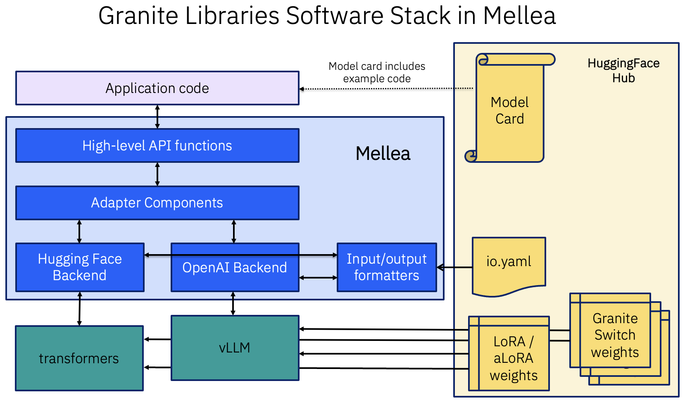

# Granite Switch Examples

This directory contains examples for running Mellea adapter functions with
Granite Switch models, either locally through `LocalHFBackend` or through an
OpenAI-compatible vLLM deployment.

## What is Granite Switch?

Granite Switch models ship with LoRA and aLoRA adapters pre-baked into the model
weights. Unlike runtime LoRA/aLoRA adapters on a standard `LocalHFBackend`,
these embedded adapters are activated via control tokens injected by the model's
chat template. Only the I/O transformation configs are downloaded — no adapter
weights are transferred.

Each checkpoint embeds its own set of adapter functions, so check the model
card on Hugging Face. These examples use `granite-switch-4.1-3b-preview`, which
embeds the RAG and core adapter functions. The released `granite-switch-4.1-8b`
and `-30b` embed `decision` and `guardian-core` instead (see
`docs/examples/intrinsics/decisions.py`). See "Choosing a model" in the
adapter-functions docs for the full list.

## Prerequisites

### Local Hugging Face inference

Run the local example on a GPU or Apple Silicon Mac:

```bash
uv sync --extra hf
```

### OpenAI-compatible inference

1. Host a Granite Switch model with [vLLM](https://docs.vllm.ai/).
2. Install the `switch` extra to download embedded adapter metadata:

```bash
uv sync --extra switch
```

## Available adapters

Not all adapter functions are embedded in every Granite Switch model. Check the
model's `adapter_index.json` for a definitive list. For Granite Switch models
pre-built by IBM, Mellea includes a list of models in `model_id`.

A checkpoint may also carry `probe` slots: classifier heads that answer with a
single label token rather than generating JSON. Mellea loads them like LoRA
slots, and you invoke them by name (conventionally `<name>_probe`); the `rag.*`
and `guardian.*` helpers do not route to them yet. The result carries the sampled
`token`, the label pool, and per-label logprobs (e.g. `{"token": "yes",
"label_logprobs": {"yes": -0.01, "no": -4.4}, "labels": ["no", "yes"], ...}`).

Label order, and therefore the meaning of each label, comes from the
checkpoint's `io.yaml`, so a probe's verdicts are only as correct as the
checkpoint. A slot whose `technology` Mellea does not recognise is skipped with
a warning; the rest of the index still loads.

## Files

### [answerability_local_hf.py](./answerability_local_hf.py)

Demonstrates `rag.check_answerability()` against a local Granite Switch
checkpoint using `LocalHFBackend(load_embedded_adapters=True)`.

### [answerability_openai.py](./answerability_openai.py)

Demonstrates `rag.check_answerability()` using `OpenAIBackend` with
`load_embedded_adapters=True` — the simplest way to use adapter functions with Granite
Switch.

### [hallucination_detection_openai.py](./hallucination_detection_openai.py)

Demonstrates `rag.flag_hallucinated_content()` using `OpenAIBackend` with
`load_embedded_adapters=True`.

### [manual_adapter_loading.py](./manual_adapter_loading.py)

Shows how to manually load embedded adapters using
`backend.register_embedded_adapter_model(intrinsic_name=...)`. Useful when
you only need a subset of adapters or want more control over adapter
registration.

## Architecture



## Related

- [`../intrinsics/`](../intrinsics/) — runtime LoRA/aLoRA adapter functions
- [Adapter Functions Documentation](../../docs/advanced/intrinsics.md)
- [Official Granite Switch Documentation](https://github.com/generative-computing/granite-switch)
