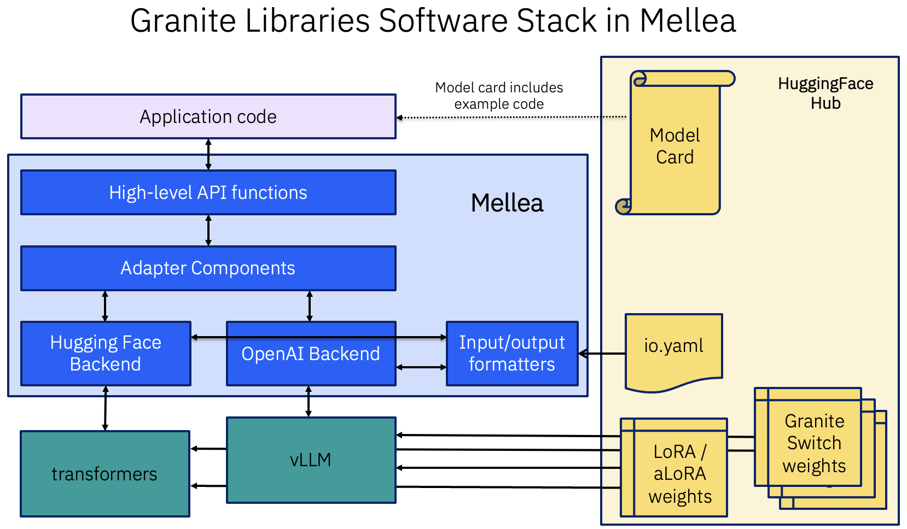

# Granite Switch Examples

This directory contains examples for running Mellea adapter functions with
Granite Switch models, either locally through `LocalHFBackend` or through an
OpenAI-compatible vLLM deployment. For setup and backend details, see
[Adapter functions](../../docs/advanced/intrinsics.md) and the
[official Granite Switch documentation](https://github.com/generative-computing/granite-switch).
For runtime LoRA/aLoRA adapters on a standard backend, see
[`intrinsics/`](../intrinsics/README.md).

Granite Switch models ship with LoRA and aLoRA adapters pre-baked into the model
weights. Unlike runtime LoRA/aLoRA adapters on a standard `LocalHFBackend`,
these embedded adapters are activated via control tokens injected by the model's
chat template. Only the I/O transformation configs are downloaded — no adapter
weights are transferred.

Not all adapter functions are embedded in every Granite Switch model. Check the
model's `adapter_index.json` for a definitive list. For Granite Switch models
pre-built by IBM, Mellea includes a list of models in `model_id`.

## Examples

| File | Description |
| :--- | :--- |
| [`answerability_local_hf.py`](./answerability_local_hf.py) | Demonstrates `rag.check_answerability()` against a local Granite Switch checkpoint using `LocalHFBackend(load_embedded_adapters=True)`. Needs a GPU or Apple Silicon Mac (`uv sync --extra hf`). |
| [`answerability_openai.py`](./answerability_openai.py) | Demonstrates `rag.check_answerability()` using `OpenAIBackend` with `load_embedded_adapters=True` — the simplest way to use adapter functions with Granite Switch. Needs a running vLLM server (`uv sync --extra switch`). |
| [`hallucination_detection_openai.py`](./hallucination_detection_openai.py) | Demonstrates `rag.flag_hallucinated_content()` using `OpenAIBackend` with `load_embedded_adapters=True`. Needs a running vLLM server (`uv sync --extra switch`). |
| [`manual_adapter_loading.py`](./manual_adapter_loading.py) | Shows how to manually load embedded adapters using `backend.register_embedded_adapter_model(intrinsic_name=...)`. Useful when you only need a subset of adapters or want more control over adapter registration. Needs a running vLLM server (`uv sync --extra switch`). |

## Architecture

